 Society Connect

Smart Society Management App | Flutter + Firebase

Society Connect is a digital society management application designed to simplify housing society operations. It helps administrators manage residents, flats, maintenance, notices and other society activities in one place.

🚀 Features

- Society creation and management
- Wing and flat management
- Resident registration and management
- Owner and tenant details
- Flat occupancy status
- Maintenance management
- Notices and announcements
- Visitor management
- Firebase-based backend

🛠️ Technology Stack

- Flutter
- Dart
- Firebase Authentication
- Cloud Firestore
- Firebase Cloud Functions

📱 Platform

- Android

🎯 Project Goal

To make housing society management easier, faster and more organized through a simple digital platform.

👨‍💻 Developer

Aashi Tech

📌 Project Status

Development and testing in progress.

⚠️ Note

This project is under development. Features and functionality may change as development continues.
## 📱 App Screenshots

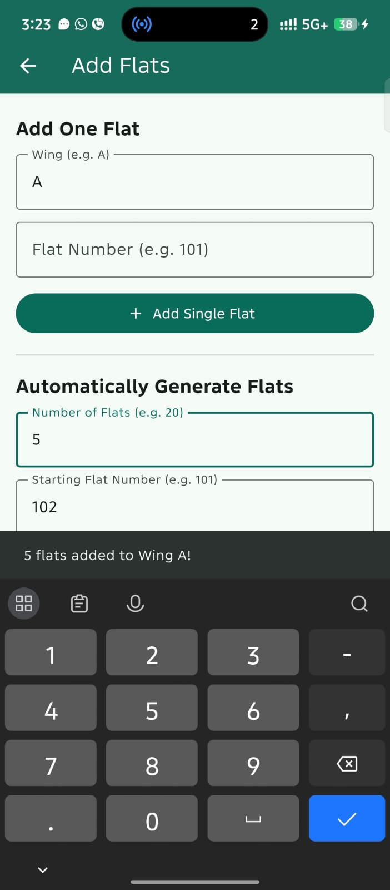
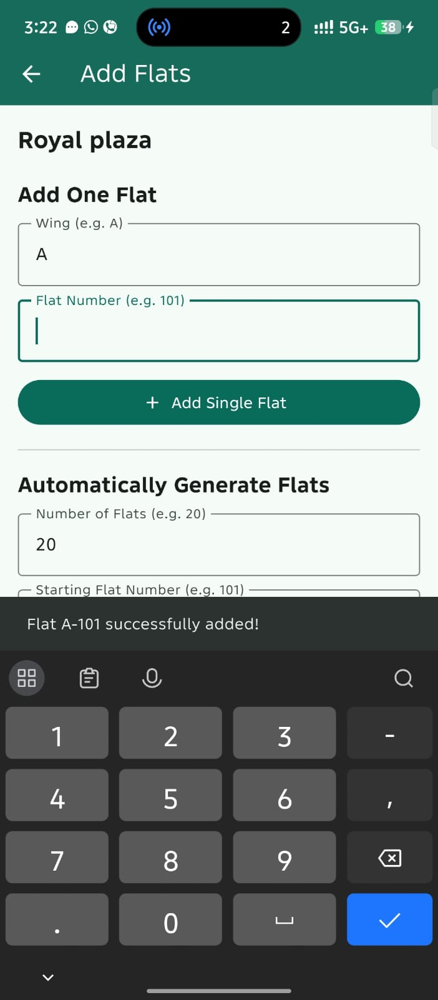
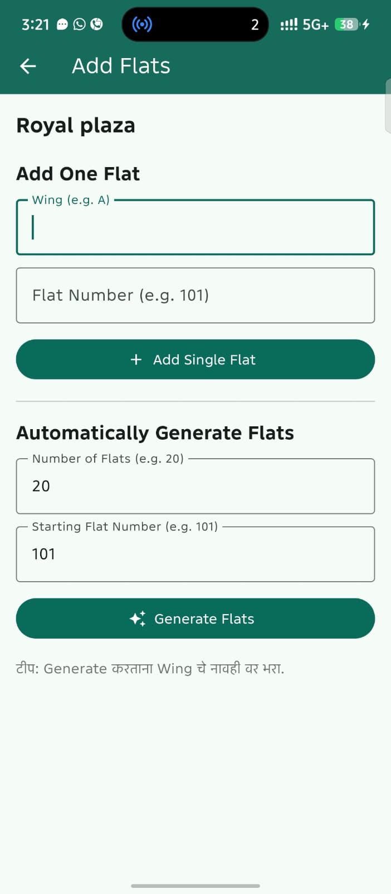
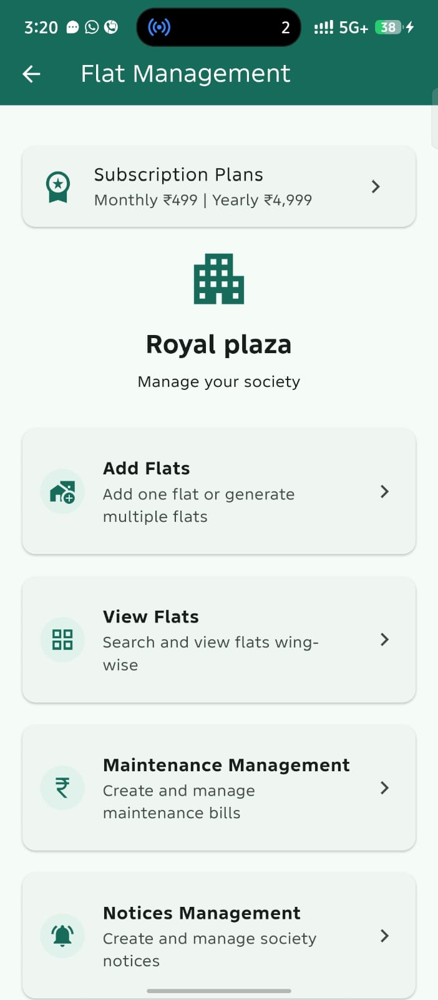
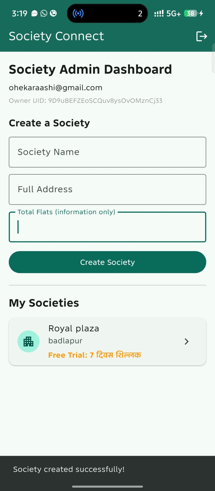
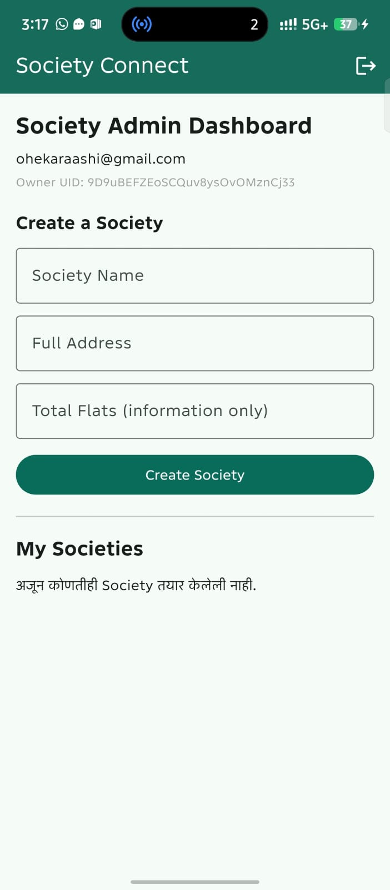
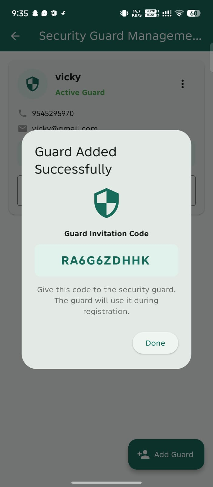
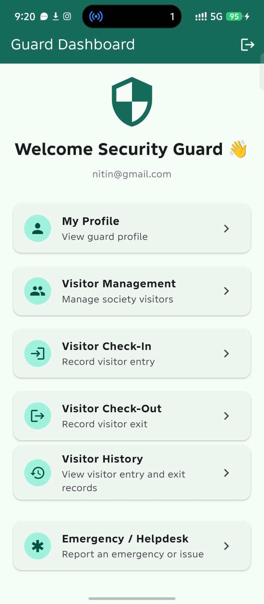
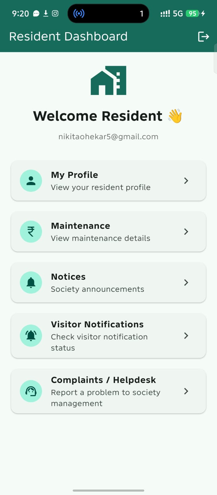
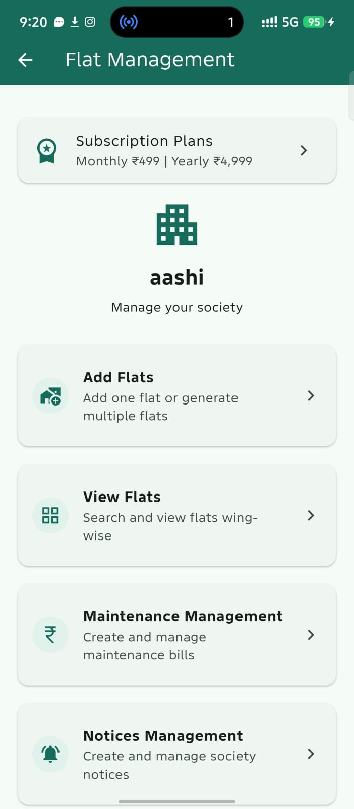
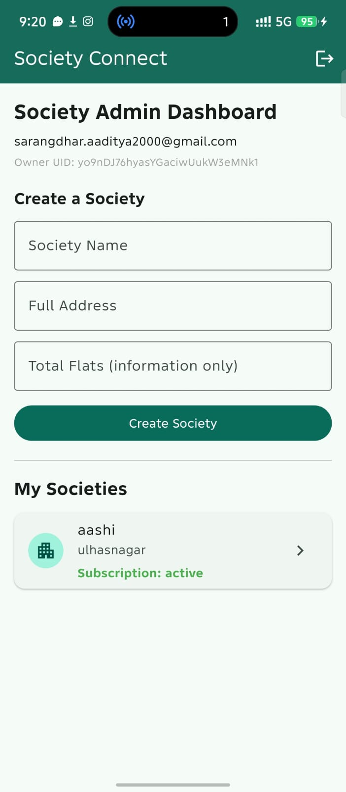
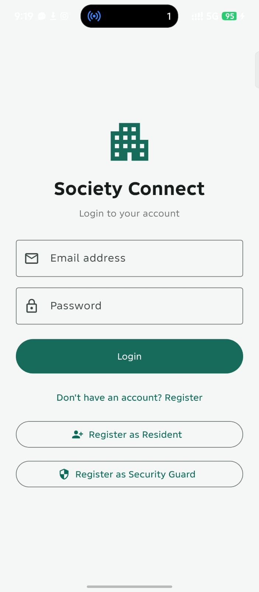
